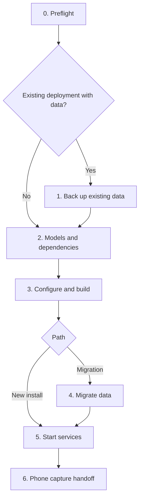

# Agent deployment runbook

This runbook is the deployment guide for Eleagent on two NVIDIA DGX Spark hosts running Linux ARM64. It covers a new installation, and moving an existing deployment's data onto Eleagent so that Eleagent becomes the production stack. It is written for an agent to execute.

Spark 1 runs capture, MiniCPM perception, the graph database, the Graph API and the Sleep scheduler. Spark 2 runs the media archive, recognition, speech, OCR and Graph Sync. At night, the host GPU managers stop the daytime GPU workers and run the GLM model across both hosts through Atlas.

## How to use this runbook

Every phase states where it runs, its success evidence, what to do on failure, and whether it is safe to repeat. Finish a phase and record its evidence before starting the next one. If an expected result does not appear, stop at that phase. Do not skip ahead.

Run commands from `deploy/dual-spark` unless a phase says otherwise. Keep a private deployment record outside the repository, for example `<root>/private/` with mode `0700`. Write a small JSON receipt for each phase: time, repository revision, image IDs, counts, checksums and check results. These receipts let a later agent resume from the right phase. They may include host addresses and paths, but never put token values in them.

### Rules that apply to every phase

- **Data is irreplaceable; models and images are not.** Never delete, recreate, `chown -R` blindly or rewrite `DATA_ROOT`, a backup or an old deployment's data directory to make a step pass.
- **Never reset worker state to fix a stuck queue.** Observer, recognition, speech and OCR keep cursors and pending queues in their state directories. A worker with no state reads the whole archive from the beginning, so deleting state reprocesses all history.
- **Never weaken a check.** Do not edit `deploy/models.lock.json`, skip hash verification, or patch a model checkpoint in place. Local runtime changes belong in the converted overlay.
- **Never open a database with an older engine than the one that last wrote it,** and never run two database processes against one directory.
- **Credentials stay private.** Never commit `.env`, a rendered `docker compose config`, `docker inspect` output, a control token or TLS keys. Do not print token values to logs or chat.
- **Ask before downloading large artifacts.** Prefer verified local copies. Get the owner's approval before downloading multi-gigabyte weights, wheels or base images.
- **Ask before irreversible or production-facing steps:** stopping a production deployment, retiring old services, or deleting anything.
- **Keep tracked files unchanged on hosts.** Put deployment-specific settings in private Compose override files and the private `.env`, not in tracked Compose files.
- **Respect model licenses.** The DFlash2 drafter is CC BY-NC-ND 4.0, and the MiniCPM demo application has no explicit source license. See [third-party notices](../THIRD_PARTY_NOTICES.md); confirm the owner accepts them before downloading.

### Choose a path



- **New install:** no recordings exist yet. Services start on empty data directories.
- **Migration:** an older deployment holds personal data. Phase 4 copies its latest data into the new data root before anything starts, and Phase 5 retires the old stack after the new one is running.

## Phase 0: Preflight

**Where:** both hosts. **Repeatable:** yes; read-only.

Collect the following and record them:

| Check | Command or source | Required result |
| --- | --- | --- |
| Architecture and OS | `uname -m`, `/etc/os-release` | `aarch64`, Linux |
| Docker and Compose | `docker version`, `docker compose version` | Compose 2.30 or newer |
| GPU containers | `docker info` runtimes; a short `nvidia-smi` container | NVIDIA Container Toolkit works |
| Service account | `id 1000` | Exists, has Docker access, owns the deployment root |
| Free space | `df -h` on the data, model and backup volumes | Archive reserve (100 GiB default) plus backup size plus models |
| Private network | Each host's private IPv4 address; ping between hosts | Both addresses reachable from each other |
| Atlas fabric | `ip -br link`, `ibv_devices` or equivalent | Interface and HCA names for the direct link, and rank 0's fabric address |
| Timezone | Owner's IANA timezone | One value used everywhere |
| Revision | `git rev-parse HEAD` on both hosts | Identical commit |
| Existing services | `docker ps -a`, `systemctl list-units --all` | Inventory of anything already using ports or GPUs |

Values that the agent must obtain rather than guess: the private addresses, fabric interface, HCA, rank-0 fabric address, timezone, owner display name and public capture hostname. Ask the owner when they cannot be read from the hosts.

The observer, recognition, speech, Sleep and GPU-manager processes must all run as UID 1000: pause, acknowledgement, readiness and control-token files deliberately use mode `0600`. Clone the repository to the same path on both hosts; the supplied systemd unit assumes `/opt/eleagent`.

**Stop if** the revisions differ, the service account is not UID 1000, or another process holds a listed port or GPU and the owner has not approved stopping it.

## Phase 1: Back up existing data

**Where:** both hosts, Migration path only. **Repeatable:** a new backup goes into a new directory; never overwrite an earlier one.

Store the backup outside the active data root, with mode `0700`, on private storage.

1. **Inventory.** Record the old deployment's repository revision, container names, image IDs, mounts, restart policies, environment, Compose configuration and GPU-manager units. Keep it private: it contains credentials. Later phases need it for the cutover and for preserving credentials.
2. **Quiesce.** Wait until any night run has finished and both GPU managers are idle with no lease. Stop both GPU managers. Stop capture ingress and Sleep on Spark 1; stop recognition, speech, OCR, Graph Sync and the archive on Spark 2. Confirm every writer has exited. Stop the Graph API and the graph database last.
3. **Copy.** Copy each host's complete data directories, private `.env`, control token, manager configuration and any private TLS or ingress configuration. Preserve ownership, permissions and symlinks. Include SQLite `-wal` and `-shm` files. Resolve symlinks that point outside the copied roots and back up their targets too; a copied link does not preserve the bytes it references.
4. **Verify.** Compare SHA-256 for every regular file and every symlink target. Run `PRAGMA integrity_check` on every SQLite copy. Run `neo4j-admin database check` against a disposable copy of the backed-up store, using **the same Neo4j image as the old deployment** and the store owner's UID.
5. **Receipt.** Record completion time, file count, byte count, checksums, database-check results and the stopped-writer inventory.

**Success:** both hosts have a receipt with matching hashes, `ok` integrity results and a passing Neo4j check.
**On failure:** keep the old services stopped until you know why, or restart them from the inventory if the owner wants capture back. Do not proceed to Phase 4 without a verified backup.

The new stack reuses the old deployment's GPUs and ports. Keep the old deployment stopped from here on, unless the owner wants capture back; restart it only with its recorded configuration.

## Phase 2: Models and dependencies

**Where:** each host prepares its own models. **Repeatable:** yes; verification never modifies model directories.

### Storage layout

Create the layout on each host. The example root is `/srv/eleagent`; use the `DATA_ROOT` and `MODEL_ROOT` chosen for `.env`.

```sh
# Both hosts
sudo install -d -m 0755 /srv/eleagent/data
sudo install -d -m 0755 -o 1000 -g 1000 /srv/eleagent/models
sudo install -d -m 0700 -o 1000 -g 1000 /srv/eleagent/data/model-metadata
sudo install -d -m 0700 -o 1000 -g 1000 /srv/eleagent/data/gpu-manager

# Spark 1
sudo install -d -m 0750 -o 1000 -g 1000 /srv/eleagent/data/observer /srv/eleagent/data/sleep
sudo install -d -m 0750 -o 7474 -g 7474 /srv/eleagent/data/neo4j/data /srv/eleagent/data/neo4j/logs
sudo install -d -m 0750 /srv/eleagent/data/minicpm-cache

# Spark 2
sudo install -d -m 2750 -o 10001 -g 10001 /srv/eleagent/data/archive
sudo install -d -m 0750 -o 1000 -g 1000 /srv/eleagent/data/recognition
sudo install -d -m 0700 -o 1000 -g 1000 /srv/eleagent/data/agent
```

The archive runs as UID 10001. Graph Sync runs as UID 1000 with supplementary group 10001 so it can read the archive database and its WAL. The model root must be writable by UID 1000; a root-owned model root makes later downloads fail. On the Migration path, skip the data directories that Phase 4 will copy in: the copy refuses existing destinations.

Expected model directories under `MODEL_ROOT`:

| Host | Directory | Purpose |
| --- | --- | --- |
| Spark 1 | `MiniCPM-o-4_5` | Daytime perception |
| Spark 2 | `entities` | Face and object weights, manifests, `voice_silero.jit` |
| Spark 2 | `campplus` | Speaker embeddings |
| Spark 2 | `qwen3-asr-1.7b` | Speech transcription |
| Spark 2 | `ocr` | Three checksum-pinned OCR ONNX files |
| Spark 2 | `qwen3.6-35b-a3b-fp8` | Local VLM for naming and the day agent (Qwen3.6-35B-A3B FP8, vLLM-loadable); another model goes in its own directory named by `VLM_MODEL_DIR` |
| Both | `glm-5.3-flash-atlas` | GLM and DFlash2 sources, plus the converted Atlas overlay |

### Order

Speech must be built before Silero can be extracted from it, and Atlas must be built before conversion. Run the model steps in this order and the image builds from Phase 3 in between:

| Order | Host | Step |
| --- | --- | --- |
| 1 | Spark 1 | MiniCPM weights: link or download, then verify |
| 2 | Spark 2 | Qwen ASR and CAM++: link or download, then verify |
| 3 | Spark 2 | Face, object and OCR weights |
| 4 | Spark 2 | Build the `speech` image (Phase 3), then extract Silero |
| 5 | Both | GLM and DFlash2 sources: link or download, then verify |
| 6 | Both | Build Atlas (Phase 3), then convert |

### Verify or download pinned weights

`deploy/models.lock.json` holds repository IDs, immutable revisions, directory names and licenses. `deploy/verify-model.py` checks large files with SHA-256 and other files, including configuration and tokenizers, with Git blob SHA-1. It never downloads weights or modifies the directory. Run from the repository root with `.env` loaded:

```sh
set -a; . deploy/dual-spark/.env; set +a
```

Reuse local copies by copying, hard-linking or symlinking them into the expected directory, then verify. Save metadata on the first check so that later checks need no network:

```sh
ln -s /path/to/existing/MiniCPM-o-4_5 "$MODEL_ROOT/MiniCPM-o-4_5"
python3 deploy/verify-model.py minicpm-o-4_5 --path "$MODEL_ROOT/MiniCPM-o-4_5" \
  --write-metadata "$DATA_ROOT/model-metadata/minicpm.json"
# Later, offline:
python3 deploy/verify-model.py minicpm-o-4_5 --path "$MODEL_ROOT/MiniCPM-o-4_5" \
  --metadata-file "$DATA_ROOT/model-metadata/minicpm.json"
```

Only when no verified local copy exists, and after the owner approves, download the exact revisions:

```sh
python3 -m venv .venv && .venv/bin/pip install huggingface_hub==0.34.6
# Spark 1
.venv/bin/hf download openbmb/MiniCPM-o-4_5 --revision 503e754207c94da6bb26850b4469f367c9ea3582 \
  --local-dir "$MODEL_ROOT/MiniCPM-o-4_5"
# Spark 2
.venv/bin/hf download Qwen/Qwen3-ASR-1.7B --revision 7278e1e70fe206f11671096ffdd38061171dd6e5 \
  --local-dir "$MODEL_ROOT/qwen3-asr-1.7b"
.venv/bin/hf download funasr/campplus --revision e4b6ede7ce16997aff4ae69fbca1f0175e2afede \
  --local-dir "$MODEL_ROOT/campplus"
# Both hosts, after the owner accepts the DFlash2 license
.venv/bin/hf download nvidia/GLM-5.3-Flash-NVFP4 --revision da920bb0b9f4a06727223a349e55468e38352348 \
  --local-dir "$MODEL_ROOT/glm-5.3-flash-atlas/nvidia--GLM-5.3-Flash-NVFP4"
.venv/bin/hf download incoai/GLM-5.3-Flash-DFlash2 --revision 7d74cdd881ed7e32c31175984a67823127b66cfe \
  --local-dir "$MODEL_ROOT/glm-5.3-flash-atlas/incoai--GLM-5.3-Flash-DFlash2"
```

Then verify each one: `minicpm-o-4_5`, `qwen3-asr-1.7b`, `campplus`, `glm-5.3-flash-nvfp4` and `glm-dflash2`, each with `--path` set to its directory. The GLM and DFlash2 sources can also be copied between the hosts over the private link and verified on each.

### Recognition weights (Spark 2)

From `services/recognition`, with `ENTITY_WEIGHTS_DIR="$MODEL_ROOT/entities"` exported. Each script reuses existing files whose pinned hashes match:

```sh
python3 download_models.py --weights-dir "$MODEL_ROOT/entities"   # add --offline to require local files
python3 object_download_models.py
python3 ocr_download_models.py --model-dir "$MODEL_ROOT/ocr"
```

After the speech image is built, extract Silero from its installed, pinned package without a download:

```sh
docker run --rm --entrypoint python -v "$MODEL_ROOT/entities:/models/entities" \
  local/eleagent-speech:production /app/voice_download_models.py \
  --weights-dir /models/entities --skip-ecapa
```

### Atlas conversion (both hosts)

After the Atlas image is built, in a maintenance window with the GPUs free, run from `deploy/atlas`:

```sh
bash convert-model.sh "$MODEL_ROOT/glm-5.3-flash-atlas" sha256:<atlas-image-id>
```

Conversion reads the source checkpoints read-only and writes a separate `atlas-overlay`, including the converted MTP quantization metadata. Keep `conversion.complete.json`, `sparkglm-verified.json` and `eleagent-overlay.json` in the overlay. The overlay links to the source checkpoints by absolute path, so do not move the sources afterward.

**Success:** every `verify-model.py` run exits 0; the recognition scripts report matching hashes; both hosts have a complete Atlas overlay with its three receipt files.
**On failure:** a hash mismatch means the files differ from the pinned revision. Obtain correct bytes. Do not edit the lock or the files. A failed conversion leaves the sources untouched; remove only the incomplete overlay and rerun.

## Phase 3: Configure and build

**Where:** both hosts. **Repeatable:** builds yes; credential and manager configuration generation refuse to overwrite.

### Private configuration

New install: generate `.env` once, without printing the credentials, then edit `SPARK1_ADDRESS`, `SPARK2_ADDRESS`, `DATA_ROOT`, `MODEL_ROOT`, `ELEAGENT_TIMEZONE`, `ELEAGENT_OWNER_NAME` and `AUTH_PUBLIC_URL` (the owner's stable public HTTPS origin):

```sh
cp .env.example .env
chmod 600 .env
python3 - <<'PY'
from pathlib import Path
import secrets
path = Path('.env')
text = path.read_text()
for key in ('SCENE_API_TOKEN', 'SCENE_ARCHIVE_TOKEN', 'NEO4J_PASSWORD'):
    text = text.replace(key + '=\n', key + '=' + secrets.token_hex(32) + '\n')
path.write_text(text)
path.chmod(0o600)
PY
```

Migration: create `.env` from the old deployment's values instead, as described in [preserving credentials](#preserving-credentials).

Transfer the identical `.env` privately to the other host. Only `DATA_ROOT` and `MODEL_ROOT` may differ between hosts. `SCENE_API_TOKEN` is now only the gateway/feeder-to-observer **internal** credential; `SCENE_ARCHIVE_TOKEN`, GPU manager keys and the Neo4j password remain private machine credentials. Never distribute them in links, QR codes or browser storage. Users sign in with email/password; MCP clients authorize with OAuth. `GRAPH_API_TOKEN` is no longer used; remove it when migrating (retain the old private configuration only for rollback). Existing graph pagination cursors expire during this upgrade; restart the query, not the database.

On Spark 1, create the private persistent auth directory as the host user matching container UID 1000:

```sh
set -a; . ./.env; set +a
install -d -m 700 "$DATA_ROOT/auth"
python3 - <<'PY'
import os, secrets
from pathlib import Path
path = Path(os.environ['DATA_ROOT']) / 'auth' / 'secret'
try:
    fd = os.open(path, os.O_WRONLY | os.O_CREAT | os.O_EXCL, 0o600)
except FileExistsError:
    pass  # Preserve an existing stable secret on upgrades.
else:
    with os.fdopen(fd, 'w') as f:
        f.write(secrets.token_urlsafe(48))
PY
```

Back up this entire directory consistently, including `auth.sqlite`, its SQLite WAL state and `secret`. Do not delete it, regenerate the secret, or overwrite owner credentials on redeploy. Run exactly one graph-api process/instance per auth database; issuance and revocation use a process-local queue. Changing `AUTH_PUBLIC_URL` changes the issuer/resource, so MCP clients must authorize again. Never derive the issuer from incoming Host/forwarding headers.

The day agent on Spark 2 hands requests to Okou with access tokens it fetches from graph-api's internal listener on Spark 1. Set `AGENT_INTERNAL_ADDR` in `.env` to the Spark 1 address on the direct Spark link plus a free port (for example `10.100.24.1:22404`); the listener binds only there. Both sides prove themselves with one shared secret. Generate it on Spark 1 and copy exactly the same file privately to Spark 2:

```sh
# Spark 1
set -a; . ./.env; set +a
python3 - <<'PY'
import os, secrets
from pathlib import Path
path = Path(os.environ['DATA_ROOT']) / 'auth' / 'agent-internal.token'
try:
    fd = os.open(path, os.O_WRONLY | os.O_CREAT | os.O_EXCL, 0o600)
except FileExistsError:
    pass  # Keep an existing secret; Spark 2 holds the same value.
else:
    with os.fdopen(fd, 'w') as f:
        f.write(secrets.token_hex(32) + '\n')
PY
# Spark 2: the same bytes at $DATA_ROOT/agent/internal.token, UID 1000, mode 0600
```

The Okou connection itself is approved by the owner in the browser after the services run (Phase 6); its tokens stay in `$DATA_ROOT/auth/okou.json` on Spark 1 and the agent never sees the refresh token.

`OBSERVER_URL` defaults to the private HTTP observer (`http://127.0.0.1:8080`). If an existing observer uses HTTPS, preserve it and set `OBSERVER_URL`, `OBSERVER_CA_HOST_FILE` (trusted host certificate path), and `OBSERVER_CA_FILE=/run/tls/observer.crt`. Certificate and hostname verification remain enabled. Public ingress must point to the authenticated graph gateway, never directly to observer/archive/GPU endpoints.

### Images

Build each image on the host that runs it. Record every image ID.

```sh
# Spark 1
docker compose --env-file .env -f compose.spark1.yaml config --quiet
docker compose --env-file .env -f compose.spark1.yaml build observer graph-api sleep
bash ../minicpm/build.sh
# Spark 2
docker compose --env-file .env -f compose.spark2.yaml config --quiet
docker compose --env-file .env -f compose.spark2.yaml build archive text graph-sync recognition speech
docker compose --env-file .env -f compose.spark2.yaml build naming    # on the recognition image
docker compose --env-file .env -f compose.spark2.yaml build agent     # on the naming image
docker compose --env-file .env -f compose.spark2.yaml pull vlm        # skip when VLM_IMAGE is already local
# Both hosts
bash ../atlas/build.sh    # prints the image ID used for conversion and the manager
```

Do not save `config` output: interpolation includes credentials. When large dependencies already exist locally, reuse them instead of downloading again:

| Image | Option | Effect |
| --- | --- | --- |
| MiniCPM | `MINICPM_WHEELHOUSE=/abs/dir` | Uses local wheel and source archives with their original filenames; lock hashes still apply |
| MiniCPM | `MINICPM_SOURCE_DIR=/abs/checkout` | Uses an existing Git checkout of the pinned upstream commit |
| MiniCPM | `MINICPM_CACHED_BASE_IMAGE=<image>` | Builds the application on an existing dependency-only image (ARM64 Python 3.12, CUDA 13 PyTorch, FFmpeg, curl); do not combine with `MINICPM_BASE_IMAGE` |
| Recognition, speech | `RECOGNITION_BASE_IMAGE=<image>` and `REUSE_INSTALLED_TORCH=1` in `.env` | Reuses exact-version installed PyTorch packages; other locked dependencies still install |
| Atlas | `ATLAS_NATIVE_ARTIFACTS_DIR=/abs/dir` | Uses extracted native libraries and converter from a local release; checksums still apply |
| Atlas | `ATLAS_SOURCE_CACHE=/abs/dir` | Uses complete local `sparkglm.git` and `engine.git` repositories instead of GitHub |
| Atlas | `ATLAS_CUDA_DEVEL_IMAGE`, `ATLAS_CUDA_RUNTIME_IMAGE` | Uses exact local CUDA 13.0 Ubuntu 24.04 base images |

### GPU managers

The managers are systemd host services outside Compose. As the UID-1000 account, generate one control token on Spark 1 and copy exactly the same file privately to Spark 2:

```sh
python3 - <<'PY'
from pathlib import Path
import os, secrets
path = Path('/srv/eleagent/data/gpu-manager/control.secret')
fd = os.open(path, os.O_WRONLY | os.O_CREAT | os.O_EXCL, 0o600)
with os.fdopen(fd, 'w') as output:
    output.write(secrets.token_hex(32) + '\n')
PY
```

Generate each host's configuration. Angle-bracket values are required inputs from Phase 0, not defaults:

```sh
set -a; . ./.env; set +a
HOST_ROLE=s1    # s2 on Spark 2
ATLAS_IMAGE_ID=$(docker image inspect --format '{{.Id}}' local/eleagent-atlas:production)
if [ "$HOST_ROLE" = s1 ]; then
  MANAGER_BIND_ADDRESS=$SPARK1_ADDRESS; WORKER_DATA_DIR=$DATA_ROOT/observer
else
  MANAGER_BIND_ADDRESS=$SPARK2_ADDRESS; WORKER_DATA_DIR=$DATA_ROOT/recognition
fi
sudo install -d -m 0750 -o 1000 -g 1000 /etc/eleagent
python3 ../../runtime/gpu-manager/generate-config.py \
  --role "$HOST_ROLE" --bind-address "$MANAGER_BIND_ADDRESS" \
  --leader-address '<rank-0-private-fabric-address>' --image-id "$ATLAS_IMAGE_ID" \
  --data-dir "$WORKER_DATA_DIR" --model-root "$MODEL_ROOT/glm-5.3-flash-atlas" \
  --repo-dir /opt/eleagent --state-dir "$DATA_ROOT/gpu-manager" \
  --fabric-interface '<interface-name>' --fabric-hca '<hca-name>' \
  --timezone "$ELEAGENT_TIMEZONE" --output /etc/eleagent/gpu-manager.json
sudo install -m 0644 ../../runtime/gpu-manager/eleagent-gpu-manager.service /etc/systemd/system/
sudo systemctl edit --full eleagent-gpu-manager.service   # set User and Group to the UID/GID-1000 account
sudo systemctl daemon-reload
sudo systemctl enable --now eleagent-gpu-manager.service
```

The manager timezone must equal `ELEAGENT_TIMEZONE`. The night window starts at 00:30, permits acquisition before 05:00, and ends at 05:30 local time. On Spark 1 the manager stops `eleagent-minicpm`; the observer, Graph API and graph keep running for uploads, sign-in and Sleep. On Spark 2 it stops recognition, speech, text, naming, the day agent and the VLM, in that order; only the archive and Graph Sync keep running, because Sleep reads the archive and Graph Sync hands it the last fragments. In the morning the VLM must answer `http://127.0.0.1:22410/health` before daytime work resumes. Any other GPU container on a host must be added with `--daytime-container <name>` (and `--ready-url` if it loads a model); otherwise its memory stays taken, the manager refuses the night with `insufficient_available_memory`, and Sleep does not run.

**Success:** all images exist with recorded IDs; `config --quiet` passes on both hosts; `systemctl is-active eleagent-gpu-manager` is `active`, and `GET http://<private-address>:9210/status` with the control token reports `idle` with no lease on both hosts.
**On failure:** registry or network errors during builds are not reasons to edit Dockerfiles. Use a reuse option above, or report the missing dependency and ask whether a download is approved.

## Phase 4: Migrate data

**Where:** both hosts, Migration path only. **Repeatable:** copying into a non-empty destination is refused; to redo it, move the incomplete destination aside with the owner's approval and start again.

Phase 4 moves the old deployment's latest data into the new data root. Eleagent then becomes the deployment that runs from now on; the old core services are not started again.

### Preserving credentials

The new production `.env` must reuse the old deployment's values. Do not generate new ones:

| Variable | Why it must be preserved |
| --- | --- |
| `SCENE_API_TOKEN` | Internal gateway/feeder-to-observer authentication only; phones no longer carry it |
| `SCENE_ARCHIVE_TOKEN` | Existing private archive clients use it |
| `AUTH_PUBLIC_URL`, `DATA_ROOT/auth` | Preserve the issuer/resource identity, owner account, sessions, OAuth grants and stable secret |
| `NEO4J_PASSWORD` | An existing database keeps its stored password; the container variable only sets the password of a new database |
| `ELEAGENT_TIMEZONE` | Diary days, sleep dates and the night window are computed in it |
| `ELEAGENT_OWNER_NAME` | Keeps the Sleep agent's owner identity unchanged |

Read these values from the old deployment's private configuration or from the Phase 1 inventory. Write them straight into a mode-0600 `.env` without printing them. Assert that the same credential agrees across every old service that uses it. Use the same file on both hosts.

### Keep the graph engine version

The tracked Compose file pins a default Neo4j image. Before starting the migrated database, read the engine version the old deployment ran, for example from its image or `neo4j --version` inside that image. If it differs from the tracked default, keep the old engine:

1. Tag the old image ID under a local name, for example `local/eleagent-neo4j:<version>-migrated`.
2. Add a private Compose override, outside the repository, that sets `graph.image` to that tag. Set `graph.user` to the UID:GID that owns the copied store if it differs from the default `7474`. Also carry over any non-default database settings from the old container.
3. Start Spark 1 through a small private launcher that always passes the override after the tracked Compose file, so later restarts cannot fall back to the default image:

   ```sh
   exec docker compose --env-file .env -f compose.spark1.yaml -f /private/path/compose.production.yaml "$@"
   ```

An older engine must never open a store written by a newer one. Upgrading the engine is a separate, explicitly approved operation with its own backup.

The same private override is the place for other deployment-specific settings carried from the old stack. For example, if the existing HTTPS ingress forwards to a different observer listener or uses TLS to the observer, configure that in the override rather than in tracked files.

### Copy

1. **Quiesce.** Confirm that every old writer and the old GPU managers are still stopped, and that no night run is in progress. If the old stack was restarted after Phase 1, stop it again in the same order and take this copy from that newer state. Phase 1's backup remains the rollback point.
2. **Map directories.** Map each old data directory to its new role and record the map:

   | Host | New directory under `DATA_ROOT` | Contents |
   | --- | --- | --- |
   | Spark 1 | `observer` | Ingress state, MiniCPM cursor and queue |
   | Spark 1 | `sleep` | Scheduler state (`scheduler.json`), run history |
   | Spark 1 | `neo4j` | Graph store `data` (and `logs`) |
   | Spark 2 | `archive` | Original media and archive databases |
   | Spark 2 | `recognition` | Entities, voice identities, speech and OCR state, cursors |

   **Copy worker state together with the archive.** If the archive is copied without the observer and recognition state, every worker starts from cursor zero and reprocesses all history.
3. **Copy.** Copy each source into a destination that does not exist yet, preserving attributes (`cp -a --reflink=auto SRC DST`). Refuse symlinks inside data directories unless their targets are copied too.
4. **Check the copy.** Compare SHA-256 for every file between source and destination before changing anything. Then, with no process holding the databases, remove copied SQLite `-shm` files, run `PRAGMA integrity_check` on every SQLite database (which replays its WAL), and run `neo4j-admin database check` with the retained engine.
5. **Ownership.** Archive UID 10001 with group-readable databases; Neo4j as chosen above; everything else UID 1000.
6. **Receipt.** Record file counts, bytes, checksum results, database checks and the directory map.

## Phase 5: Start services

**Where:** both hosts. **Repeatable:** yes; `up -d --no-build` never touches data.

Start Spark 2's services, then Spark 1's daytime services. On the Migration path, use the launcher from Phase 4 on Spark 1. Do not start `sleep` yet:

```sh
# Spark 2
docker compose --env-file .env -f compose.spark2.yaml up -d --no-build
# Spark 1
docker compose --env-file .env -f compose.spark1.yaml up -d --no-build graph minicpm observer graph-api
```

Wait for readiness: Neo4j healthy, MiniCPM `http://127.0.0.1:22400/health` reporting `model_loaded: true`, the VLM's `http://127.0.0.1:22410/health` answering 200 on Spark 2, recognition and speech readiness markers written, and `python3 ../../runtime/gpu-manager/ready.py --config /etc/eleagent/gpu-manager.json` exiting 0 on both hosts as UID 1000. Model loading can take several minutes. Confirm the observer's private `GET http://127.0.0.1:8080/` returns the page and anonymous upload remains rejected. At the gateway, unauthenticated `GET http://127.0.0.1:22403/` must redirect to sign-in; unauthenticated MCP/graph/media calls return 401. Complete the first-owner initialization below before handing the public address to the owner.

### First-owner initialization (choose email, generate password)

Ask the owner which email account to use **before the first initialization**; do not hard-code a team or example email. Public signup and public `/auth/setup` are disabled. Provision the account only through the local CLI. There is no user-facing API key or setup token.

With the runtime image built, run on Spark 1 from `deploy/dual-spark` (include the same private Compose overrides used for production):

```sh
read -r -p 'Owner email: ' OWNER_EMAIL
docker compose --env-file .env -f compose.spark1.yaml stop graph-api
init_status=0
docker compose --env-file .env -f compose.spark1.yaml run --rm --no-deps -T \
  --entrypoint node graph-api init-owner.mjs --email "$OWNER_EMAIL" || init_status=$?
docker compose --env-file .env -f compose.spark1.yaml up -d --no-deps --no-build graph-api
unset OWNER_EMAIL
test "$init_status" -eq 0
```

The stopped graph-api ensures exactly one process writes its auth database. The CLI generates a 256-bit random password and durably stores `email`, `password` and `signinURL` in `${DATA_ROOT}/auth/initial-owner.txt` (container `/data/auth/initial-owner.txt`), owner-only mode 0600, **before** creating the owner. It prints only the filepath, never the password. Give the owner this file through a verified owner-only channel, or let them read it in a private terminal; never paste the password in chat, logs, command arguments, URLs, QR codes, Git or public artifacts. Existing owner/credentials cause a refusal, never a password reset. If initialization fails after persistence, keep the recovery file/latch and investigate; never delete auth state to rerun blindly.

The owner opens `${AUTH_PUBLIC_URL}/auth/sign-in` and uses that email/password. After signing in, open `/auth/account` → **Change password**, enter the initial/current password and the new password twice (12–128 characters). The current session remains signed in and other browser sessions are revoked; the initial credentials file is not updated with the new password. Capture uses the secure HttpOnly session cookie; MCP clients use `${AUTH_PUBLIC_URL}/mcp` with Authorization Code + S256 PKCE, discovery and scoped OAuth tokens (`graph:read`, `media:read`). Resource endpoints do not accept browser cookies or old shared keys. Revoke connected applications at `/auth/account`; revocation also invalidates outstanding authorization codes and access/refresh credentials. Provider upgrades require rerunning the pinned-schema revocation regression tests.

CIMD clients may serve their metadata and product homepage (`client_uri`) on different public origins, such as API and app subdomains. Eleagent permits this display-only field to be cross-origin while retaining same-origin binding for `post_logout_redirect_uris`. The official pinned HTTPS metadata-fetch transport, client-ID/document identity checks, public HTTP(S) homepage URL validation, explicit owner consent, S256 PKCE and exact registered OAuth redirect matching remain enforced. This policy does not add a trusted origin or authorize a callback based on the homepage URL.

On the Migration path, also confirm that the data was carried over before starting `sleep`:

| Check | Required result |
| --- | --- |
| Archive | Media count, event count and ingest head equal the old deployment's |
| Worker progress | Every observer, recognition, speech and OCR cursor equals the archive head; pending queues are empty or match the old values |
| No reprocessing | Worker event counts do not jump after startup |
| Identity data | Entity, sample and voice-identity counts equal the old deployment's |
| Graph | An OAuth client authorized for `graph:read` reads the migrated entities; shared static keys and browser cookies are not MCP/graph access tokens |
| Sleep state | `scheduler.json` shows the last day the old deployment slept |

Then, with both managers `idle`, start the scheduler on Spark 1:

```sh
docker compose --env-file .env -f compose.spark1.yaml up -d --no-build sleep
```

Its first run is the next local night between 00:30 and 05:00 in `ELEAGENT_TIMEZONE`. Do not trigger a manual night run or change the timezone to force one.

Keep internal listeners private. Only the authenticated gateway, through the `AUTH_PUBLIC_URL` origin, is reachable by capture clients:

| Listener | Bind |
| --- | --- |
| Internal observer | Spark 1 loopback `8080` (or the preserved private HTTPS listener), never a direct public tunnel |
| Authenticated capture / graph / MCP gateway | Spark 1 loopback `22403`, public only through the configured HTTPS origin |
| MiniCPM worker / backend | Spark 1 loopback `22400` / `22500` |
| Neo4j Bolt | Spark 1 private address `7687`; HTTP console disabled |
| Archive | Spark 2 private address `22401` |
| GPU managers | Each host's private address `9210`, bearer authenticated |
| GLM HTTP | Spark 1 loopback `8893`, during Sleep only |
| Metrics | Host loopback, ports set in each Compose service |

**On failure:** read the failing service's logs and its state. Do not delete its state to clear an error. If a night run fails, the managers restore daytime services at the hard deadline, when a lease expires, or after a manager restart; wait for that before investigating, and do not start or remove Atlas rank containers by hand.

### Retire the old stack (Migration path)

After the new stack is running, ask the owner before this step. Then:

1. Stop the old core containers and set their restart policy to `no` (`docker update --restart=no`). Do not remove them.
2. Stop and disable the old GPU manager units. Only the new `eleagent-gpu-manager` stays enabled.
3. Point surrounding services, such as the HTTPS ingress, tunnels and monitoring, at the new containers. Keep the public origin unchanged.
4. Keep the old data directories, the old containers and the Phase 1 backup. Removing them needs a separate retention decision from the owner.
5. Write the cutover receipt: preserved counts, image IDs, private override path, retired services and backup location.

**On failure before retirement:** stop the new stack and restart the old one from its inventory; its data was only read. **On failure after retirement:** stop the new stack, verify Phase 1's backup, and ask the owner before restoring, because new recordings may exist only in the new root.

## Phase 6: Phone capture handoff

**Where:** Spark 1 and the owner's phone. **Repeatable:** yes.

1. Phones allow camera and microphone access only on a secure origin. Make the authenticated gateway `127.0.0.1:22403` reachable at the HTTPS origin configured in `AUTH_PUBLIC_URL`, forwarding **every path**, including `/auth/*`, `/api/auth/*`, `/.well-known/*`, `/mcp`, `/assets/*` and `POST /`. How that origin is provided is the owner's choice. Never disable certificate validation. Confirm `GET /` over HTTPS from outside the private network.
2. Give the owner the plain `https://<capture-host>/` URL (a QR may contain only that ordinary URL, no credentials). Anonymous visits redirect to email/password sign-in; sign-in returns to capture. Do not distribute service keys or create token fragments. After verifying the unified origin, retire old public tunnels that directly expose observer. Keep the internal observer/archive/GPU listeners private.
3. The page starts recording as soon as it opens. The owner allows the camera, microphone and location, keeps the page in the foreground, and speaks normally for 10–15 seconds. The page has two controls: record/pause, and switching between the back and front cameras. Switching apps or locking the phone pauses recording, and returning to the page resumes it. Clips wait in the browser's bounded queue until the server confirms archival, so browser data must not be cleared while uploads are pending.
4. Confirm on the servers: new clips archived, MiniCPM, recognition, OCR and speech events for them, a non-empty transcript, and queues draining. Short queues after a burst of buffered uploads are normal; a growing backlog is not.
5. Connect Okou: the Okou mark at the bottom left of the capture page is grey until Eleagent is connected. The owner taps it, signs in to Okou and approves; the page comes back with the mark in colour. Confirm with the owner's session that `GET /okou/status` reports `connected: true`, and on Spark 2 that the agent logs `start` with an Okou thread. Then a spoken request such as "Okou, book a meeting with … tomorrow afternoon" shows "已交给 Okou：…" on the phone and arrives in the owner's Okou chat.

**On failure:** check upload responses first. a gateway `401` means the session expired—sign in again without clearing pending clips; an internal backend authentication failure is a server configuration issue, not a reason to ask the user for a token; a conflict means a capture identity was reused for different bytes. Then check that each service is running and its queue is moving.
